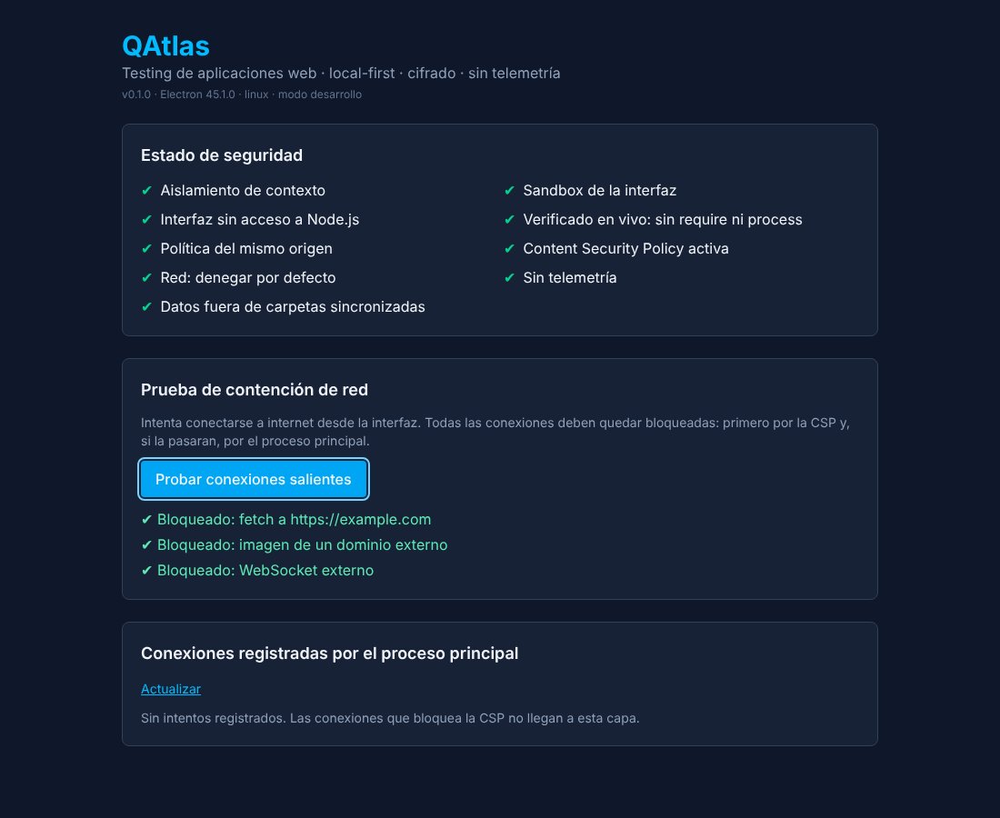

# QAtlas

**Aplicación de escritorio para testing de aplicaciones web — local-first, cifrada y sin telemetría.**

QAtlas permite escanear una aplicación web autorizada, importar casos de prueba y scripts de UAT desde
Excel, ejecutarlos de forma manual o automatizada y generar reportes de bugs con evidencia, sin que
ningún dato salga del equipo salvo por una acción explícita del usuario.



> **Estado:** fase 1, semana 1 — estructura base endurecida. Ver el [plan por fases](docs/especificacion-qatlas.md).

## Por qué

- Los casos de prueba y los scripts de UAT viven en Excel, desconectados de la automatización.
- Las herramientas de testing en la nube obligan a subir URLs, credenciales y capturas de sistemas
  internos a servidores de terceros.
- Arreglar un bug y romper otra cosa es habitual cuando no hay una regresión repetible.

## Seguridad primero

La seguridad no se agrega al final: es lo primero que se construye y se verifica en cada versión.

| Control                                                                    | Estado         |
| -------------------------------------------------------------------------- | -------------- |
| Interfaz en sandbox, sin Node, con aislamiento de contexto                 | ✅             |
| Content Security Policy estricta (`connect-src 'none'`)                    | ✅             |
| Red de la interfaz: denegar por defecto, con registro                      | ✅             |
| Protocolo propio `app://` (sin `file://`), protegido contra path traversal | ✅             |
| IPC tipado: valida origen, entrada **y salida**                            | ✅             |
| Sin permisos del navegador, sin ventanas nuevas, sin `<webview>`           | ✅             |
| Datos fuera de carpetas sincronizadas (OneDrive, Dropbox…)                 | ✅             |
| Scripts de instalación bloqueados (`ignore-scripts`) con lista permitida   | ✅             |
| Bóveda cifrada (SQLCipher + AES-256-GCM, Argon2id)                         | ⏳ semanas 2-3 |
| Proxy de salida para el navegador de pruebas                               | ⏳ semana 5    |
| Redacción y detector de secretos; test del secreto canario                 | ⏳ semana 7    |

Detalle: [SECURITY.md](SECURITY.md) · [modelo de amenazas](docs/modelo-de-amenazas.md) ·
[especificación, sección 3](docs/especificacion-qatlas.md).

## Stack

Electron · React 19 + TypeScript · Vite · Tailwind CSS · Zod · Vitest · Playwright ·
(próximamente) SQLite + SQLCipher, Drizzle, ExcelJS, FFmpeg.

## Estructura

```
apps/
  desktop/          App Electron: main (seguridad, IPC), preload (puente mínimo), renderer (React)
  sandbox-site/     App de prueba con errores y trampas plantadas (semana 4)
packages/
  shared/           Contrato IPC con Zod, compartido por todos los procesos
  crypto/ db/ runner/ redaction/ importers/ exporters/   (se implementan por fases)
security-tests/     Suite de seguridad TS-01 a TS-14 (obligatoria en CI)
e2e/                QAtlas probándose a sí misma con Playwright
docs/               Especificación, modelo de amenazas, decisiones técnicas
```

## Requisitos

- Node.js 22 o superior
- Git
- Windows 10/11, macOS 13+ o Linux

## Cómo empezar

```bash
npm run setup        # npm ci + scripts de instalación permitidos (binario de Electron)
npm run dev          # app en modo desarrollo con recarga en caliente
```

## Comandos

| Comando                  | Qué hace                                                                |
| ------------------------ | ----------------------------------------------------------------------- |
| `npm run check`          | Todo lo que corre el CI: lint, tipos, tests y Electronegativity         |
| `npm test`               | Tests unitarios y suite de seguridad                                    |
| `npm run test:security`  | Solo la suite de seguridad                                              |
| `npm run build`          | Compila la app                                                          |
| `npm run test:e2e`       | Abre la app compilada y la prueba con Playwright (correr `build` antes) |
| `npm run audit:deps`     | Auditoría de dependencias                                               |
| `npm run audit:electron` | Análisis estático de seguridad de Electron                              |

## Documentación

- [Especificación funcional, técnica y de seguridad](docs/especificacion-qatlas.md)
- [Modelo de amenazas](docs/modelo-de-amenazas.md)
- [Decisiones técnicas](docs/decisiones/)
- [Triage de Electronegativity](docs/seguridad/electronegativity.md)
