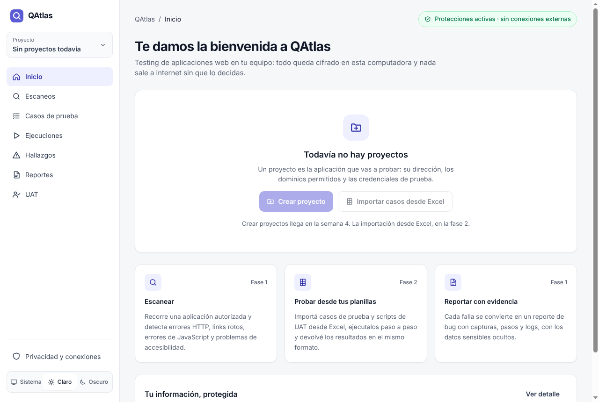
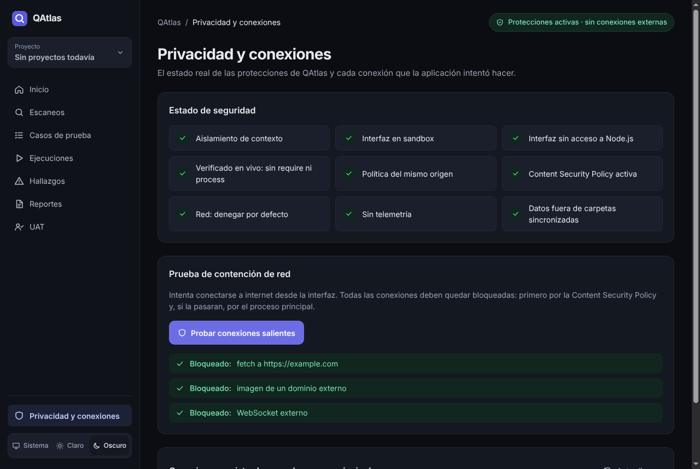

# QAtlas

**Aplicación de escritorio para testing de aplicaciones web — local-first, cifrada y sin telemetría.**

QAtlas permite escanear una aplicación web autorizada, importar casos de prueba y scripts de UAT desde
Excel, ejecutarlos de forma manual o automatizada y generar reportes de bugs con evidencia, sin que
ningún dato salga del equipo salvo por una acción explícita del usuario.

| Modo claro                                      | Modo oscuro                                       |
| ----------------------------------------------- | ------------------------------------------------- |
|  |  |

> **Estado:** fase 1, semana 3 — estructura base endurecida, sistema de diseño Índigo y bóveda cifrada con desbloqueo, bloqueo automático y copia de seguridad. Ver el [plan por fases](docs/especificacion-qatlas.md).

## Por qué

- Los casos de prueba y los scripts de UAT viven en Excel, desconectados de la automatización.
- Las herramientas de testing en la nube obligan a subir URLs, credenciales y capturas de sistemas
  internos a servidores de terceros.
- Arreglar un bug y romper otra cosa es habitual cuando no hay una regresión repetible.

## Seguridad primero

La seguridad no se agrega al final: es lo primero que se construye y se verifica en cada versión.

| Control                                                                                            | Estado      |
| -------------------------------------------------------------------------------------------------- | ----------- |
| Interfaz en sandbox, sin Node, con aislamiento de contexto                                         | ✅          |
| Content Security Policy estricta (`connect-src 'none'`)                                            | ✅          |
| Red de la interfaz: denegar por defecto, con registro                                              | ✅          |
| Protocolo propio `app://` (sin `file://`), protegido contra path traversal                         | ✅          |
| IPC tipado: valida origen, entrada **y salida**                                                    | ✅          |
| Sin permisos del navegador, sin ventanas nuevas, sin `<webview>`                                   | ✅          |
| Datos fuera de carpetas sincronizadas (OneDrive, Dropbox…)                                         | ✅          |
| Scripts de instalación bloqueados (`ignore-scripts`) con lista permitida                           | ✅          |
| Esquema de claves y cifrado (Argon2id, AES-256-GCM, HKDF): paquete crypto                          | ✅          |
| Bóveda en la app: SQLCipher, primer inicio y desbloqueo con freno                                  | ✅          |
| Bloqueo manual, por inactividad, al suspender, al bloquear el sistema y al cerrar                  | ✅          |
| Canales IPC rechazados por defecto con la bóveda bloqueada                                         | ✅          |
| Copia de seguridad cifrada y restauración, con ruta elegida en el proceso principal                | ✅          |
| Borrado criptográfico: claves, `secure_delete` y lápidas (una copia ya hecha conserva el proyecto) | ✅ parcial  |
| Integridad de los módulos nativos (completa con fuses y firma, semana 10)                          | ✅ parcial  |
| Test de datos personales en el repositorio                                                         | ✅          |
| Proxy de salida para el navegador de pruebas                                                       | ⏳ semana 5 |
| Redacción y detector de secretos; test del secreto canario                                         | ⏳ semana 7 |

Detalle: [SECURITY.md](SECURITY.md) · [modelo de amenazas](docs/modelo-de-amenazas.md) ·
[especificación, sección 3](docs/especificacion-qatlas.md).

## Stack

Electron · React 19 + TypeScript · Vite · Tailwind CSS (tokens propios, Inter y JetBrains Mono empaquetadas) · Zod · SQLite + SQLCipher · Drizzle · Vitest · Playwright ·
(próximamente) ExcelJS, FFmpeg.

## Estructura

```
apps/
  desktop/          App Electron: main (seguridad, IPC), preload (puente mínimo), renderer (React)
  sandbox-site/     App de prueba con errores y trampas plantadas (semana 4)
packages/
  shared/           Contrato IPC con Zod, compartido por todos los procesos
  crypto/           Esquema de claves, cifrado de archivos y de campos
  db/               SQLCipher, esquema, migraciones, archivo sellado y copia de seguridad
  runner/ redaction/ importers/ exporters/   (se implementan por fases)
security-tests/     Suite de seguridad TS-01 a TS-14 (obligatoria en CI)
e2e/                QAtlas probándose a sí misma con Playwright
docs/               Especificación, modelo de amenazas, decisiones técnicas
```

## Requisitos

- Node.js 22 o superior
- Git
- Windows 10/11 x64 (por ahora; ver las [limitaciones de plataforma](packages/crypto/README.md#plataformas))

## Cómo empezar

```bash
npm run setup        # npm ci + scripts de instalación permitidos (binario de Electron)
npm run dev          # app en modo desarrollo con recarga en caliente
```

## Comandos

| Comando                        | Qué hace                                                                 |
| ------------------------------ | ------------------------------------------------------------------------ |
| `npm run check`                | Lint, tipos, tests, cobertura y Electronegativity                        |
| `npm test`                     | Tests unitarios y suite de seguridad                                     |
| `npm run test:security`        | Solo la suite de seguridad                                               |
| `npm run test:coverage`        | Crypto, base y bóveda con cobertura (mínimo 80 %)                        |
| `npm run build`                | Compila la app                                                           |
| `npm run test:e2e`             | Prueba la app compilada y corre crypto y base en Electron (tras `build`) |
| `npm run test:crypto:electron` | Solo crypto, base, TS-02 y TS-09, dentro del runtime real de Electron    |
| `npm run audit:deps`           | Auditoría de dependencias                                                |
| `npm run audit:electron`       | Análisis estático de seguridad de Electron                               |

## Documentación

- [Especificación funcional, técnica y de seguridad](docs/especificacion-qatlas.md)
- [Modelo de amenazas](docs/modelo-de-amenazas.md)
- [Sistema de diseño](docs/diseno/sistema-de-diseno.md)
- [Decisiones técnicas](docs/decisiones/)
- [Triage de Electronegativity](docs/seguridad/electronegativity.md)
- [Cómo contribuir](CONTRIBUTING.md)
