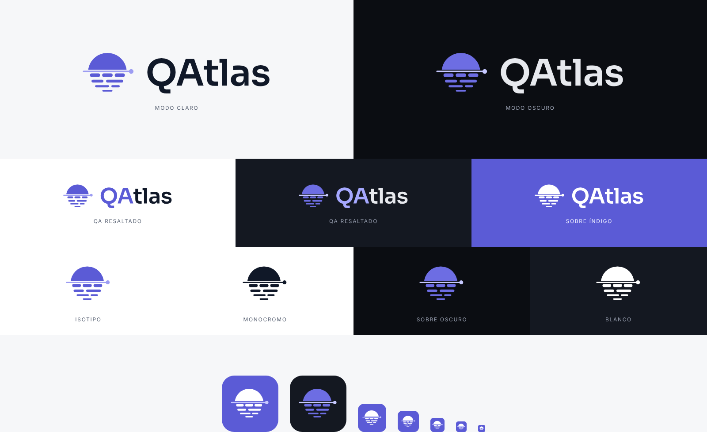

# Marca de QAtlas

## Concepto

El símbolo es **un escaneo**: el círculo es la aplicación que se prueba, vista como un mundo
entero (el "atlas"). La línea horizontal es el escaneo que la recorre; arriba, lo ya mapeado
(sólido); abajo, los trazos que el escaneo va revelando (pantallas, estados, casos). El punto
al final de la línea es la prueba en curso.

## Archivos

| Archivo                                              | Uso                                                 |
| ---------------------------------------------------- | --------------------------------------------------- |
| `logo-claro.svg` / `logo-oscuro.svg`                 | Logo principal (símbolo + nombre) según el modo     |
| `logo-claro-qa.svg` / `logo-oscuro-qa.svg`           | Variante con "QA" en índigo, para venta y portfolio |
| `logo-negro.svg` / `logo-blanco.svg`                 | Un solo color (impresión, fondos de color)          |
| `isotipo-color.svg` / `isotipo-color-oscuro.svg`     | Símbolo solo                                        |
| `isotipo-negro.svg` / `isotipo-blanco.svg`           | Símbolo en un solo color                            |
| `isotipo-animado.svg`                                | Símbolo animado (SMIL): pantalla de carga, demos    |
| `icono-app.svg` / `icono-app-oscuro.svg`             | Fuente del ícono de la aplicación (48 px o más)     |
| `icono-app-chico.svg` / `icono-app-oscuro-chico.svg` | Versión simplificada para 16, 24 y 32 px            |
| `nombre.svg`                                         | Solo el nombre                                      |
| `banner-venta.png`                                   | Banner 1200 × 630 (LinkedIn, portfolio, portada)    |

Los íconos para la app están en `apps/desktop/resources/`: `icon.png` (1024 px), `icon-512.png` e
`icon.ico` (16, 24, 32, 48, 64 y 256 px, con la versión chica en 16, 24 y 32).

## Reglas

- **Tipografía del nombre:** Sora SemiBold (OFL), con su kerning. En los SVG está convertida a
  trazos, así que no depende de tener la fuente instalada. La interfaz sigue usando Inter.
- **Colores:**

  | Elemento         | Modo claro | Modo oscuro | Token del sistema de diseño        |
  | ---------------- | ---------- | ----------- | ---------------------------------- |
  | Círculo y trazos | `#5B5BD6`  | `#6D6DE3`   | `accent` / `accent-hover` (oscuro) |
  | Línea de escaneo | `#9C9CF2`  | `#C7C9FF`   | — / `accent-soft-text` (oscuro)    |
  | Nombre           | `#101828`  | `#E7E9EE`   | `text`                             |
  | "QA" resaltado   | `#5B5BD6`  | `#A5A8FF`   | `accent` / `accent-text` (oscuro)  |

  `#9C9CF2` es un color nuevo, solo de marca: no existe como token.

- **Tamaño mínimo:** el logo con nombre, 24 px de alto. Por debajo de 48 px, usar las versiones
  `-chico` del ícono.
- **Área libre:** alrededor del logo, al menos la altura de la "Q" del nombre.
- No deformar, rotar, cambiar colores fuera de esta tabla ni agregar sombras o degradados.

## Integración

- **Interfaz:** el isotipo es el componente `Logo` (`apps/desktop/src/renderer/src/ui/Icon.tsx`), en el
  menú lateral y en las pantallas de primer inicio y de bóveda bloqueada. Usa los tokens `--qa-brand` y
  `--qa-brand-scan`, el recorte con `useId()`, y la geometría chica por debajo de 32 px.
- **Ventana y barra de tareas:** `icon` del `BrowserWindow`: `icon.ico` en Windows, `icon.png` en el resto.
- **Instalador (semana 10):** `apps/desktop/resources/`.
- **README del repo:** el logo con `<picture>` y `prefers-color-scheme`.
- **Sistema de diseño:** sección «Marca» en `docs/diseno/sistema-de-diseno.md`.
- **Capturas:** `docs/captura-claro.png` y `docs/captura-oscuro.png`, con el logo nuevo.

Los íconos se generan desde estos SVG con `node scripts/marca.mjs --generar`, y los metadatos se quitan con
`node scripts/marca.mjs --limpiar`. Ninguna imagen del repo puede tener metadatos: lo verifica
`security-tests/privacidad-repo.test.ts`.

**Pendiente:** a 16 px el ícono se reconoce, pero la línea de escaneo se funde con la esfera. Falta una versión
dibujada para 16 px, alineada a la grilla de píxeles.
